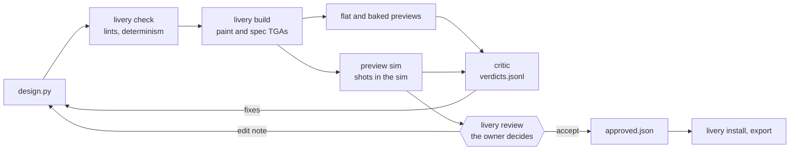
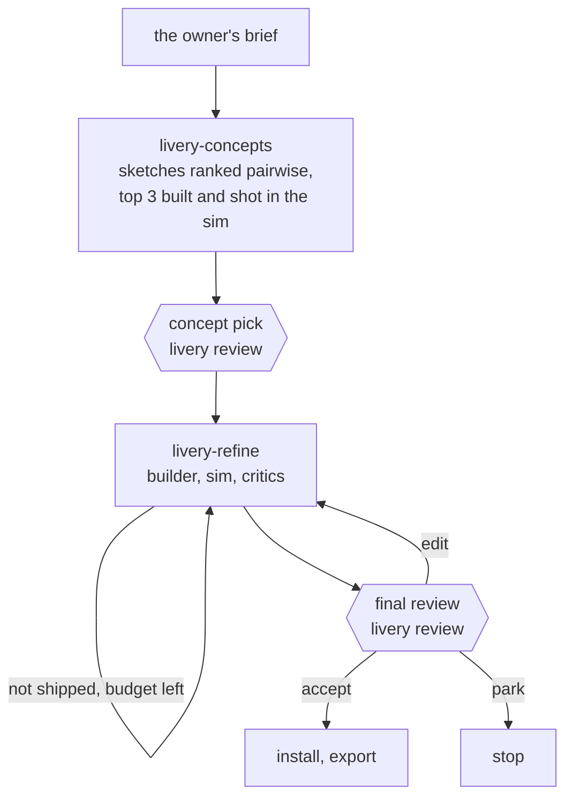

# Architecture

The `livery` CLI does every deterministic step and writes files; agents judge those files and edit design scripts. How iRacing behaves, as measured, is in `docs/sim.md`.

## Principles

- A build comes only from its script, kit and assets, and `livery check` proves it repeats byte for byte. Nothing under `.cache/` is committed.
- Hashes decide what is stale. Checks, previews, approvals and installs record the build they belong to, and a mismatch is rebuilt or refused, never trusted.
- The owner decides and agents propose: two checkpoints per design (concept pick and final) on the review page. Accepting pins one exact build, and only that build installs.
- The sim belongs to the owner. Runs never send input or focus, raise or restore its window, they queue for one lock, and they stop when the owner brings the sim to the front. A run may resize a normal window behind other windows, and puts its size back.
- The critic sees renders, never scripts, and compares rather than scores.

## Layout

| Path | Holds | Committed |
|---|---|---|
| `designs/<name>/` | `design.py`; `brief.md` and `notes.md` (where it stands now); `verdicts.jsonl`; `approved.json`; its own `sponsors/` | yes |
| `kits/<kit>/` | a car's kit, written only by `livery kit` | yes |
| `assets/` | fonts, roster brands (`sponsors/`), race markings (`marks/`) | yes |
| `prefs/`, `references.md` | the owner's decisions, words and favourite liveries | yes |
| `policy.toml` | lint thresholds, the views a preview shoots and the sim window's size | yes |
| `livery/` | the library and the CLI | yes |
| `.claude/` | agents, skills, workflows, hooks and permissions | yes |
| `.cache/` | build output, previews, critic packs, reference pictures | no |
| `%LOCALAPPDATA%\fartstriber` | machine state for every worktree: `config.toml`, the sim lock's holder, the paint journal, install backups, clean-shot references, the review queue, kit captures, telemetry (`FARTSTRIBER_STATE` moves it) | no |

## Designs

- `design.py` has a module-level `KIT = "<kit>"` literal and `build(kit, p) -> Livery`.
- It runs in a fresh module on every build, so no state carries over. `KIT` is read from the source, so hashing never runs a design. What it prints goes to stderr.
- `ROLE = "fixture"` marks a design that checks a kit or the library and is never raced. Designs that only tests build live in `tests/fixtures/designs/`.
- `p` is the script's `Params`, a frozen dataclass subclassing `livery.params.DesignParams`. Each knob is `param(default, lo, hi)` or `param(default, choices=...)`; `--set k=v`, wedge sheets and seed sheets override knobs by name, checked against type and range.
- Randomness comes only from `p.rng("name")`, seeded from `p.seed` and the stream's name, so adding a stream never shifts another.
- A `Livery` is a base colour and material plus elements. Each element has an id, kind, SVG in template pixels, material, z-order and tags, and where it sits in car space for the lints.

## Design library

Designs draw in car space through the kit's maps:

- Side views: u runs from the nose (0) to the tail (1); v from the sill (0) to the top of the side (1).
- Top view: u as on the sides; w from left (-1) to right (1).
- Faces (`front`, `rear`: what faces forward at the nose and backward at the tail): w as on top, v as on the sides. A kit has the faces its fit mapped (`kit.face_views`); `kit.side_views` never includes them.

A primitive that covers several views returns one element per view, with the view appended to its id. `band` and `stripe` cover a face only when their u range reaches its end.

| Module | Gives |
|---|---|
| `livery.primitives` | `band`, `stripe`, `shape`: cut to every island they land on. `text`, `sponsor`: laid out flat at an anchor, in a reading frame per view, clipped to the anchor's island (`mirror_sides` lays the glyphs out again, never mirrored). `panel`, `pattern_fill`, `clip_to`, `clip_out`: on regions (a body-model part or group, an island id, a view). `marks`. `svg(raw)`: the escape hatch in template pixels |
| `livery.geom` | many pieces projected in batches, raked and grown at the view's scale, cleaned to the lint's minimum feature; `geom.outline` strokes a shape's edge at the same width on every island, never along a seam |
| `livery.typeset` | type as glyph geometry (fontTools, kerned as resvg kerns), so type crosses seams; `type_block` stacks a designation and small lines on a raked plate |
| `livery.patterns` | hazard tape, dissolves, dash runs that end a band, stripe bundles, chevron lanes, pixels scattered over unmapped islands |
| `livery.carspace` | car-space polygons mapped onto every island of their view and cut to its measured area, with no clip paths |
| `livery.sponsors` | the helpers a brand's `draw.py` uses |

- `kit.part(name)`, `kit.parts()`, `kit.feature(name)` and `kit.features()` give the body model in car space; `marks` anchors on a feature.
- Snapping: where an edge would fail the near-tangent lint, it is moved onto the line or clear of its reach, whichever moves it less, by at most the reach. `lint.json` and `check.json` list every move under `snaps`. A designed piece that no snap clears is an error; a dissolve drops that cell instead; type plates are never snapped.
- The library reads its sizes from the lint thresholds (`geom.edges`), so a design never copies a lint number.
- `waive(element, check, reason)` turns off one output-lint check for one element. `check.json` lists every waiver, its reason and the findings it hid.

## Sponsors

- A brand is a folder: one-colour SVG variants (`wordmark`, `lockup`, `mark`), a `brand.toml`, and the `draw.py` that drew them. Builds read only the SVGs; a redrawn variant loses its approval.
- Roster brands live in `assets/sponsors/`, indexed by `roster.md`: name, category, lettering voice, mark, colours, the name-check evidence and the owner's yes or no.
- A design's own themed brands live in `designs/<name>/sponsors/`. They are looked up first and need no approval.
- `source = "supplied"` marks a real logo kept byte for byte, `"owned"` the Fireproof brand.
- `brand.toml` records per variant its aspect, ink share, thinnest stroke, narrowest counter and approval date. A variant's minimum height is `min_stroke_px` divided by the smaller of its stroke and counter. A `large_only` brand never goes below `large_min_px`.
- `sponsor` places one brand by `height` or `fit=(w, h)`, in one colour or `"own"`, and refuses any variant below its minimum height.
- `sponsor_group` spreads brands along a line, each sized by (ink × aspect)^-0.25. A group that doesn't fit shrinks, and fails rather than go below a minimum.
- Race markings (tow, cut-off switch, extinguisher…) are brands in `assets/marks/`. `marks` places one at a car-space anchor; a marking that points has a variant drawn for each direction.
- Unapproved roster variants and markings build and preview. A final review and `livery install` need them approved (`review --sponsors`, `review --marks`).

## Lints

Both lints run inside `livery check`, which fails on any error, and alone as `livery lint`, which writes `lint.json`. Their thresholds live only in `policy.toml` `[lint]`, and a missing one is an error.

| Lint | Looks at | Flags |
|---|---|---|
| Source (`lint/source.py`) | `design.py`, without running it. It runs first, so a failing script is never hashed or run | imports from outside math, dataclasses, typing, itertools, numpy, shapely and livery; `random`, `time`, `hash`, `id`, `open`, `eval` and the like; mutable module state; a missing `KIT` or `build`. It warns on edits to a primitive's SVG text, `__dict__` copies, and literal island ids the body model names |
| Output (`lint/output.py`) | each element rendered alone at half resolution, against the kit | off the islands; over keep-clear zones or `keep_clear` features (errors for text, logos and markings); text or logos under an `occluder` (warning) or reading mirrored; `crosses_seam` elements that cover one side of a seam pair; near-tangent edges; transparency, filters, masks and `<image>`; sizes below the minimums; too many colours; colour under metal brighter than the finish can show (`finish_reach`, warning); low contrast under the number |
| Camera (`livery.visibility`) | the kit's calibration capture, once later elements are painted over | warnings only: text, sponsors and markings no view sees well, or that straddle a crease; detail mostly unseen; lines narrower on screen than `min_screen_px` in every view. Without the capture they are skipped with a note, and no hash covers it |
| Near-tangent (`lint/edges.py`) | each edge against its own island's lines where the paint stops: island outlines (less seams), shut lines and keep-clear outlines | an edge that runs within `near_tangent_px` of a line for `near_tangent_run_px` or more without meeting it |

## Build

1. Compile the elements in z-order into one SVG group each, above a `base` group.
2. Make the spec SVG: the same document, with every colour replaced by its material's spec colour (R metallic, G roughness, B clearcoat).
3. Render both with resvg, with fonts only from `assets/fonts`.
4. Bleed: pixels outside the islands, up to the kit's bleed width, and each island's 2 px rim take the nearest inside colour, so mipmaps never blend in the background.
5. Compensate: paint under a metal finish takes the kit's lookup (`kit spec`); colour beyond what the finish can show becomes white.
6. Write uncompressed 24-bit TGAs: 32-bit with alpha can render black.

Outputs go to `.cache/designs/<name>/`: `layers.svg`, `spec.svg`, `paint.png`, `spec.png`, `car.tga`, `car_spec.tga` and `check.json`.

## Gates

`livery check` builds twice in one process and once in a fresh interpreter with a different `PYTHONHASHSEED`, and fails on any byte difference: the fresh process catches set and dict order that follows the hash seed. It writes `check.json` with the result, the output digests and three hashes of what a build reads:

| Hash | Covers | Leaves out |
|---|---|---|
| Design | the script; its kit's files; the fonts, variant SVGs and `brand.toml` it can load from `assets/` and its own `sponsors/` | `profile.toml`, `approved.json`, approval dates, `draw.py`, `roster.md`, licences |
| Toolchain | the livery modules a build can import (comments stripped), the runtime dependency versions and Python | the CLI, critic and sim code |
| Policy | `policy.toml` `[lint]` | the rest of `policy.toml` |

- Approving a kit or a brand sends no design back through check, and neither does editing the CLI or a comment.
- `livery build` reuses a passed `check.json` whose three hashes are all current; otherwise it runs check, and writes nothing if check fails.
- `preview sim` and `install` refuse a build that doesn't match its `check.json`.
- Errors that say what to do next are `LiveryError`s: the CLI prints the message and exits 1 (2 for a bad argument). Any other exception is a bug and keeps its traceback.
- Line ends are LF everywhere, and text is hashed with CRLF read as LF.

## Previews

| Preview | Command | Writes |
|---|---|---|
| Flat | `preview flat [--set k=v]` | `flat/` (`flat-sets/<key>/` with `--set`): `views.png`, the sides and top through the maps; `car.png`, the iRacing UI's front three-quarter view (a layout check with no spec, number or light); `squint.png`; `overlay.png`, the wireframe, keep-clear zones, shut lines and body features |
| Baked | `preview flat --baked` | `baked/`: each preview view as the sim would show the build, rendered from the kit's calibration capture without the sim |
| Sheet | `sheet <design> --wedge k=a..b..step`, `--seeds a..b`, `sheet a b c` | tiles of one design across values, or of several designs (`--baked` for baked tiles) |
| Sim | `preview sim` | `sim/<time>/`: one shot per preview view (The sim) |

- Every preview records the build it shows: TGA digests, design and toolchain hashes, and the `--set` values. A final review, an approval or a critic pack takes only previews of the checked build: a stale `flat/` is rendered again, but stale sim shots can't be.
- A baked pixel samples paint and spec at its texel from linear-light mips, filtered as a GPU's anisotropic filter does (at the mip of the footprint's short axis, up to 8 taps along the long axis). Each material is looked up in that pixel's grey ladder, and the sim's number shows from the background frame.
- A capture bakes only while everything its shots depend on holds (the window size, the presets' ladders, canvas, frame, preview views, replay, track camera set, graphics options and car model), and only after `livery bake check <kit> [design]` has passed. Bake check compares baked renders with one real sim run and passes when the p95 of every channel in every view is 12 or less. It takes the sim, so it is the session's step, not a builder's. `livery bake status` says whether baked views are usable.

## Kits

A kit (`kits/<kit>/`) is written only by the `livery kit` commands.

| File | Holds |
|---|---|
| `kit.yaml` | canvas, paint folder, views, bleed, spec presets and their compensation, keep-clear boxes, version, and fingerprints of the template and the car model |
| `maps.json`, `seams.json` | islands, fitted maps, seam pairs |
| `body.yaml` | the body model: parts, groups and features |
| `overlays/`, `regions.svg` | islands, mask, keep-clear zones, shut lines, wireframe |
| `profile.toml` | how the sim shows the car: replay, frame, car size, camera groups and poses, the critic's crops |
| `fit-report.json`, `review.yaml` | the last fit's report; open questions for the kit review |
| `approved.json` | the owner's accept, with the hash of the kit's other files |

`kit add <psd> --car <kit> --paint-folder <folder>` runs these steps in order. It skips each step that is done and stops wherever the owner is needed.

| Step | Command | Does |
|---|---|---|
| Extract | `kit extract` | islands from the template's dashed green outlines (grown 3 px to close), keep-clear zones from its number and sponsor blocks, shut lines, the mirror axis |
| Cameras | `preview cameras <kit> [--arm]` | car-locked preview groups in the track's camera set (The sim) |
| Frame | `sim pick-frame <kit>` | the straightest on-track frame where every preview view sees the whole car, centred; `--check` proves the shots repeat |
| Capture | `kit capture <kit> [--resume]` | Gray-code geometry and a grey ladder per spec preset, at the preview views |
| Finishes | `kit spec <kit> [--preset m=R,G,B]` | per-preset compensation for metal finishes, from the ladders |
| Fit | `kit fit <kit> [--compare] [--keep <ids>]` | maps from car space to texture pixels |
| Label | `kit label <kit> <parts.json> <features.json>` | the body model |
| Review | `kit review <kit>` | labelled overlays and the calibration livery in the preview shots, for the owner to accept |

- A fit or body change raises the version and clears the approval; any other change to the kit's build inputs voids it too. A final review and `install` refuse a kit that isn't approved as it is.
- Capture, fit and review refuse a kit whose car model iRacing has since updated.
- A pose the profile lacks is the McLaren's, scaled to the car's size.

Capture:

- The geometry (`livery.graycode`) codes all 11 bits of a texel's u and v in 8 patterns, each shot with its inverse (why: `docs/sim.md`, Rendering).
- White and black probes give the car's pixels and each bit's confidence. A plane fit over neighbours gives each pixel's texel to a fraction of one, and its footprint.
- Each paint is a sim run of its own, so other runs queue between paints.
- It keeps `geometry.npz`, `ladder.npz` and a manifest per view. `kit-capture/<kit>/current` in the state dir points at the last whole run.

Fit:

- It needs five views: each side square-on, the two three-quarters (for up-facing strips) and the top. It also reads `front` and `rear_chase` (the faces) and `side_high` (door shoulders) when the capture has them, and no other view. A map holds only where it was measured.
- Each well-seen side panel gets a quadratic from (u, v) to (x, y) plus a residual grid, and small islands get affine maps. An island neither side saw takes its partner's map, reflected. Top islands are mapped from the top shot (`docs/sim.md`, Fitting from the preview views); `side_high`, carried into the top's (u, w), fills what the top shot missed of a shoulder.
- A face view's frame is a homography to (w, v), anchored on the cells it shares with the side panels (v) and the top shot (w) near its end. An island no side maps gets a face map when it has no top map or its top map fails (p90 or dropped samples); the order is side, top, face. `kit.yaml` lists the faces that got maps.
- `seams.json` pairs texture points that are the same spot on the car.
- `--compare` writes nothing: per island and view, it reports the old and new error, how far paint moves, the islands that change view, and each approved design's share of moved pixels.

The body model:

- Parts are paint by name: whole islands, an island cut by a car-space polygon, or the `rest` of an island. Groups paint parts together.
- Features are car-space geometry of one kind: `keep_clear` (the sim draws over it), `occluder` (it hides paint from some views), `opening`, `unseen`, `zone`, `line` or `place`.
- Each part and feature says how sure the labelling was, and why; unsure ones go to the kit review.

## The sim

- `livery.iracing` uses only SDK reads and broadcasts: seek, play speed, camera, the UI flag and texture reload. `livery.capture` grabs the window with Windows Graphics Capture.
- The preview views (`policy.toml` `[preview]`) are car-locked camera groups. `livery preview cameras` adds them to the camera set of the track the kit's replay is at, beside the stock cameras.
  - Each group sits in the car's frame, so a view frames the car the same way whichever view came before.
  - Default poses, for a car the McLaren's size: each side square-on from 25 m, the top 5° off vertical, a low front three-quarter and a high rear three-quarter.
  - The replay is placed by frame, not session time.
- The owner saves the track's camera set once, from the sim's camera tool. `preview cameras` keeps the stock set as `track.cam.stock` (`--restore` puts it back), and changes `camera.ini` only while the sim is closed (`--arm` waits for that).

Every sim run is a `SimSession`: preview, capture, the spec reshoot, kit review, pick-frame and install.

| Stage | What it does |
|---|---|
| Lock | holds the named mutex `Local\fartstriber-sim`, so every worktree queues for the one sim; the kernel frees it if its holder dies |
| Recover | replays the paint journal of any run that died |
| Wait | says once what it needs, then waits until the sim is on the kit's replay with its car, the camera groups and its window open, behind other windows. A run that shoots then gives the window the client size `policy.toml` `[preview] window` names, once, and only a normal window (it may grow past its monitor); a maximised, fullscreen or minimised one at another size is waited for |
| Run | notes the camera, UI, frame and speed, and uses one capture session. Before every broadcast and frame it checks that the sim is still behind other windows and not minimised, and stops if not, or if a frame isn't at the run's size |
| Reload | old paint, then grey, then new paint; it waits for a steady frame |
| Leave | puts back the paint files, camera, UI, replay and window size, on errors too, and leaves a sim in front alone; writes `manifest.json` |

- `preview sim` refuses a build that doesn't match its `check.json`. It installs the build under the session's paint name and shoots into `sim-partial/<time>/`, renamed `sim/<time>/` once every shot is taken.
- A shot with the replay UI over the car (drawn while the cursor is over the sim) is taken again once, then refused.
- `livery sim status` reports what the next run would find, without sending the sim anything.

## Paint folder

- Sim runs write through a journal in the state dir (`paint-journal/<run>/`): each original is saved before its first write and put back at the end. The next run replays a dead run's journal.
- `livery install` writes the approved build under both names, `car_<customerID>` and `car_team_<TeamID>`.
  - It backs up what was there first; `--restore` puts it back.
  - It warns while Trading Paints Downloader runs.
  - It reloads so the sim builds the spec `.mip`, archives the `.mip` to `archive_dir` and removes the spec TGA. `--finish`, after a session of the other kind, does the same for the other name.
- `livery export` copies the approved TGAs and the archived `.mip` under Trading Paints' upload names into `~/Documents/Fartstriber/export/<design>/`.

## Review

- One localhost page (port 8765) serves every session on the machine, one item at a time.
- Each `livery review` queues its items as a group in the state dir (`review/<id>/`) and blocks until the owner presses Apply on that group. Whichever waiting review holds the port serves the page; when it exits, the next one takes over.
- A checkout has one waiting review at a time. A group whose process died stays on the page, and the next review from that checkout takes it over.
- `--list` lists the groups; `--cancel` takes this checkout's group off the page.

| Flag | Items |
|---|---|
| `<designs>` | several are concepts to pick or mix; one is a final |
| `--kit <kit>` | a kit's overlays and calibration shots |
| `--roster` | proposed brands in `roster.md` |
| `--sponsors` | drawn brands with an unapproved variant, then the `sponsor-roster` car |
| `--marks` | unapproved race markings |
| `--references` | `references.md` rows |
| `--proposals <file>` | a retro's proposed edits (`[{title, body}]`) |

| Key | Decision |
|---|---|
| A | accept (for a design: good enough to race) |
| E | edit, with a note |
| R | reject |
| S | skip |
| M | mix concepts, with a note |
| P | park a design: stop iterating, not approved |
| 1–4 | rate a design: done with it, fine, would race, love it |
| Shift+A | accept every undecided reference, roster row or brand |

- A design item shows its sim shots in view order, then the flat views, the UI's car and the squint.
- It opens with the owner's last decision and note on that design, the critic's judgement of the note, and `diff/reviewed-vs-now.png`.
- The critic's scores and call never reach the page, so they can't anchor the owner.

Apply runs in the checkout that queued the group:

1. It writes what review owns: a kit's approval, the yes/no columns of `roster.md` and `references.md`, and brand and marking approvals. These come first, so a final that places a brand accepted in the same review can be pinned.
2. It appends every decision to `prefs/decisions.jsonl`: the note verbatim, the rating, the sim runs shown, the design hash, and the critic's verdict on that hash.
3. It commits exactly what it wrote, plus each decided design's folder, and never pushes.

It prints the decisions as JSON, and the agent writes `prefs/log.md` from them in the owner's words (lines starting `Context:` are the agent's).

## Approvals

- Accepting a final writes `designs/<name>/approved.json`: the output digests; the design, toolchain and policy hashes and the design hash's parts; the waivers; and the roster variants and markings it places. Its paint, spec and flat pictures are kept in `.cache/approved/<name>/<digest>/`.
- Nothing is pinned if the build changed while the review was open, if `flat/` no longer shows it, or if it places an unapproved variant or marking.
- `livery install` installs only the approved build, and only while what it places is approved. `--unapproved` overrides that, and says so.
- `livery build --all` builds every design and reports each as approved, changed, unapproved or failed, with fixtures listed apart. It exits 1 when a design failed or an approved one changed.
- For a changed design it lists what moved and the share of pixels that moved more than `approvals.TOLERANCE`, and writes `diff/approved-vs-now.png`.

## Critic

A fresh `livery-critic` subagent judges each pack: it has only the Read tool, its model is pinned and it gets no CLAUDE.md. A judge compares more reliably than it scores, and favours whichever image comes first, so most of its jobs are comparisons run in both orders.

`livery critic pack` makes a folder of what the critic may see, never the script. Every pack holds the rubric, the taste table, `references.md`, `prefs/log.md`, and per design `kit.md` (what the sim draws over the car and what hides its paint).

| Pack | Holds |
|---|---|
| Round (no flag) | the latest sim run of the checked build, with distance images (shrunk to 200 px, enlarged 3×) and close crops; the squint; the brief; the reference and boring-anchor pictures; earlier verdicts with the builder's answers; the owner's latest note. It refuses a stale check, sim runs of another build and unanswered fixes |
| `--baked` | the same, from baked renders, for the autonomous middle rounds |
| `--compare` | this round and the last, as A/B and as B/A, unlabelled |
| `--adversary` | a round without history or note, for a critic hunting the most boring part |
| `--pairs c1 c2 …` | one pack per ordered pair of concepts: flat views, `car.png`, squint, brief |

| Command | Records in `verdicts.jsonl` |
|---|---|
| `critic record` | a round: each of the last round's fixes and the owner's note marked resolved, partly or not, with the image that shows it; every taste row; scores and a 1–10 (logged only); up to three fixes; iterate or rework; `lint_missed` and `blocked` |
| `critic compare` | better or worse where both orders agree, else same |
| `critic adversary` | up to three findings, the most boring first |
| `critic rank --pairs <dir>` | a Bradley-Terry ranking of concepts |
| `critic answer` | the builder's reply to each fix: done, blocked or skipped |

`critic status` says a design ships only when all of these hold:

- the last round was judged on sim shots
- no fix that isn't optional is open, and nothing is blocked
- every taste row passes
- the owner's latest note is resolved
- the compare with the round before isn't worse
- the adversary's top finding is optional
- the design hasn't changed since

Two compares in a row that come out the same are a plateau.

## Design sessions

- The owner decides twice, at the concept pick and at the final; the `livery-iterate` skill runs the session.
- `livery-concepts` (in `.claude/workflows/`) writes concept briefs from different sources and a sketch for each. Critics judge every pair in both orders, and the top three are built and shot in the sim.
- `livery-refine` runs rounds of a fresh builder, the sim and fresh critics until the design ships, or its budget (4 rounds), a blocked fix or a plateau stops it.
  - Once the kit has passed bake check, middle rounds use baked renders; the last round uses sim shots.
  - A plateau or a rework call forks three variants once, ranked pairwise against the design. A winning variant is adopted.
- Both workflows stop before `livery review`, because a workflow takes no input mid-run. Workflow scripts have no shell, so the CLI steps between agents run in small agents.
- A `livery-builder` owns the design named on its prompt's first line (`design: <name>`). Its hooks refuse writes outside `designs/<name>/` and the scratchpad, and shell commands other than the livery CLI, `uv run` and git. It is sent back once if it changed a file outside `designs/`.

## Records

| Record | Where | Committed |
|---|---|---|
| Verdicts | `designs/<name>/verdicts.jsonl` | yes |
| Decisions | `prefs/decisions.jsonl`, written by Apply | yes |
| The owner's words | `prefs/log.md` | yes |
| Approvals | `approved.json` in designs and kits | yes |
| Where a design stands | `brief.md`, `notes.md` (now only; the history is in git and the verdicts) | yes |
| Telemetry | `telemetry.jsonl` in the state dir: every livery command, sim run, install and review decision | no |

- `livery status [design]` builds nothing. It reports the check, the TGAs, the approvals, whether the previews are fresh, and the critic's last round.
- `livery stats` reports sim runs, rounds, the critic against the owner's decisions, `lint_missed` by kind, time per stage and waits for the sim lock.
- Every command takes `--json`.

## Settings

| File | Scope | Holds |
|---|---|---|
| `policy.toml` | the checkout, hashed | lint thresholds, preview views, the sim window's size |
| `config.toml` in the state dir | the machine, shared by every worktree | the owner's name, customer and team IDs, the archive folder, the iRacing folders, the sim's process, the preview replay (file, sha256, SubSessionID, track, `camera.ini`) |
| `kits/<kit>/profile.toml` | the kit | how the sim shows its car |

- `livery.example.toml` documents every key, and `livery config show` prints them. A missing key is a `ConfigError` that names it.
- Messages, help texts, approvals and the critic's pack use the owner's name, or "the owner" without one.
- Tests use settings of their own.

## Non-goals

- Image- or SVG-generation models, and vectorising their output
- Rebuilding Trading Paints' Paint Builder
- Mesh or Blender pipelines
- Sim speed: an 18 s loop isn't the bottleneck
- Packaging or releases
