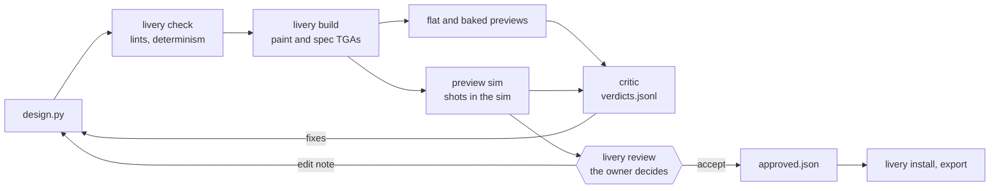
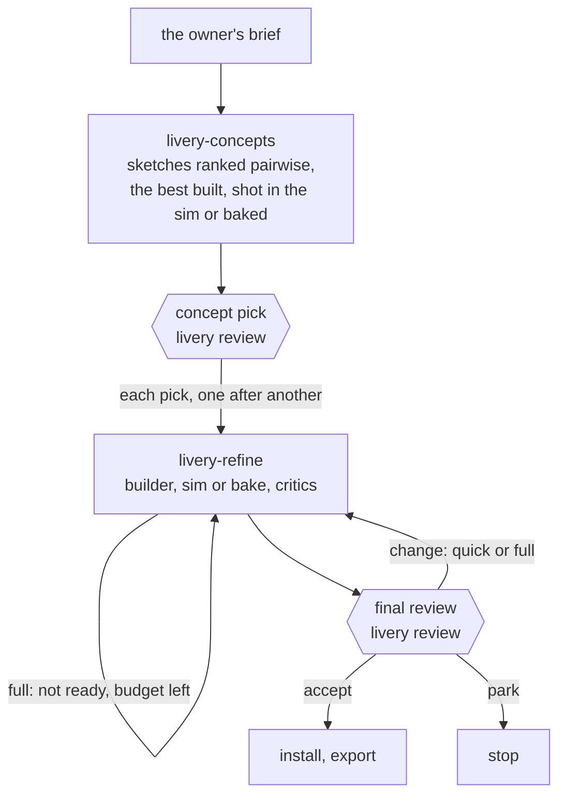

# Architecture

The `livery` CLI does every deterministic step and writes files; agents judge those files and edit design scripts. How iRacing behaves, as measured, is in `docs/sim.md`.

## Principles

- A build comes only from its script, kit and assets, and `livery check` proves it repeats byte for byte. Nothing under `.cache/` is committed.
- Hashes decide what is stale. Checks, previews, approvals and installs record the build they belong to, and a mismatch is rebuilt or refused, never trusted.
- The owner decides and agents propose: two checkpoints per design (concept pick and final) on the review page. Accepting pins one exact build, and only that build installs.
- The sim belongs to the owner. Runs never send input or focus, raise or restore its window, they queue for one lock, and they stop when the owner brings the sim to the front. A run may resize a normal window behind other windows, and puts its size back.
- The critic sees renders, never scripts, and compares rather than scores.

## Layout

| Path | Holds | Committed |
|---|---|---|
| `designs/<name>/` | `design.py`, its records (Records) and its own `sponsors/` | yes |
| `kits/<kit>/` | a car's kit, written only by `livery kit` | yes |
| `assets/` | fonts, roster brands (`sponsors/`), race markings (`marks/`) | yes |
| `prefs/<person>/`, `references.md` | each reviewer's decisions, words and taste table; the favourite liveries | yes |
| `policy.toml` | lint thresholds, the views a preview shoots and the sim window's size | yes |
| `livery/` | the library and the CLI | yes |
| `.claude/` | agents, skills, workflows, hooks and permissions | yes |
| `.cache/` | what commands write for this checkout: builds, previews, critic packs and the like | no |
| `%LOCALAPPDATA%\fartstriber` | what belongs to the machine and its sim rather than a checkout, shared by every worktree: `config.toml`, the sim lock, the paint journal, captures and the like (`livery.state`; `FARTSTRIBER_STATE` moves it) | no |

## Designs

- `design.py` has a module-level `KIT = "<kit>"` literal and `build(kit, p) -> Livery`.
- It runs in a fresh module on every build, so no state carries over. `KIT` is read from the source, so hashing never runs a design. What it prints goes to stderr.
- `ROLE = "fixture"` marks a design that checks a kit or the library and is never raced. Designs that only tests build live in `tests/fixtures/designs/`.
- `p` is the script's `Params`, a frozen dataclass subclassing `livery.params.DesignParams`. Each knob is `param(default, lo, hi)` or `param(default, choices=...)`; `--set k=v`, wedge sheets and seed sheets override knobs by name, checked against type and range.
- Randomness comes only from `p.rng("name")`, seeded from `p.seed` and the stream's name, so adding a stream never shifts another.
- A `Livery` (`livery.model`) is a base colour and material plus elements: SVG in template pixels, each recording where it sits in car space for the lints.

## Design library

Designs draw in car space through the kit's maps:

- Side views: u runs from the nose (0) to the tail (1); v from the sill (0) to the top of the side (1).
- Top view: u as on the sides; w from left (-1) to right (1).

A primitive that covers several views returns one element per view, with the view appended to its id.

| Module | Gives |
|---|---|
| `livery.primitives` | `band`, `stripe`, `shape`: cut to every island they land on. `text`, `sponsor`: laid out flat at an anchor, in a reading frame per view, clipped to the anchor's island (`mirror_sides` lays the glyphs out again, never mirrored). `panel`, `pattern_fill`, `clip_to`, `clip_out`: on regions (a body-model part or group, an island id, a view). `marks`. `svg(raw)`: the escape hatch in template pixels |
| `livery.geom` | many pieces projected in batches, raked and grown at the view's scale, cleaned to the lint's minimum feature; `geom.outline` strokes a shape's edge at the same width on every island, never along a seam |
| `livery.typeset` | type as glyph geometry (fontTools, kerned as resvg kerns), so type crosses seams; `type_block` stacks a designation and small lines on a raked plate |
| `livery.patterns` | the 10 m devices, lint-clean by construction (its docstring lists them) |
| `livery.carspace` | car-space polygons mapped onto every island of their view and cut to its measured area, with no clip paths |
| `livery.sponsors` | the helpers a brand's `draw.py` uses |

- `kit.part(name)`, `kit.parts()`, `kit.feature(name)` and `kit.features()` give the body model in car space; `marks` anchors on a feature.
- Snapping: where an edge would fail the near-tangent lint, it is moved onto the line or clear of its reach, whichever moves it less, by at most the reach. `lint.json` and `check.json` list every move under `snaps`. A designed piece that no snap clears is an error; a dissolve drops that cell instead; type plates are never snapped.
- The library reads its sizes from the lint thresholds (`geom.edges`), so a design never copies a lint number.
- `waive(element, check, reason)` turns off one output-lint check for one element. `check.json` lists every waiver, its reason and the findings it hid.

## Sponsors

- A brand is a folder: one-colour SVG variants (`wordmark`, `lockup`, `mark`), a `brand.toml`, and the `draw.py` that drew them. Builds read only the SVGs; a redrawn variant loses its approval.
- Roster brands live in `assets/sponsors/`, one `roster.md` row each, with the owner's yes or no. The owner judges a row with its drawn brand (`review --sponsors`), and designs place every drawn brand whose row isn't a no.
- A design's own themed brands live in `designs/<name>/sponsors/`. They are looked up first and need no approval.
- `source = "supplied"` marks a real logo kept byte for byte, `"owned"` the Fireproof brand.
- `brand.toml` holds each variant's measures and approval. A variant's minimum height is `min_stroke_px` divided by the smaller of its thinnest stroke and narrowest counter. A `large_only` brand never goes below `large_min_px`.
- `sponsor` places one brand by `height` or `fit=(w, h)`, in one colour or `"own"`, and refuses any variant below its minimum height.
- `sponsor_group` spreads brands along a line, sized between equal heights and equal ink (`primitives.OPTICAL`). A group that doesn't fit shrinks, and fails rather than go below a minimum.
- Race markings (tow, cut-off switch, extinguisher…) are brands in `assets/marks/`. `marks` places one at a car-space anchor; a marking that points has a variant drawn for each direction.
- Unapproved roster variants and markings build and preview. A final review and `livery install` need them approved (`review --sponsors`, `review --marks`), one tile each.
- Dropping a brand or a marking (a no on its tile, or Drop in the Library) unapproves its variants and keeps its drawing for a redraw. Every approved car placing it is held: it doesn't install until a new final without it, or the drop is undone.

## Lints

Both lints run inside `livery check`, which fails on any error, and alone as `livery lint`, which writes `lint.json`. Their thresholds live only in `policy.toml` `[lint]`, and a missing one is an error.

| Lint | Looks at | Flags |
|---|---|---|
| Source (`lint/source.py`) | `design.py`, without running it. It runs first, so a failing script is never hashed or run | imports outside its allowlist, and nondeterministic or unsafe modules and calls (`lint/source.py` lists both); mutable module state; a missing `KIT` or `build`. It warns on edits to a primitive's SVG text, `__dict__` copies, and literal island ids the body model names |
| Output (`lint/output.py`) | each element rendered alone, against the kit | every check in `lint.output.CHECKS`, by the name `waive` takes: where the element lands on the car, and what of it the sim can show. Text, logos and markings over a strict keep-clear zone (`keep_clear_strict`) or a `keep_clear` feature are errors |
| Camera (`livery.visibility`) | the kit's calibration capture, once later elements are painted over | warnings only, on what no preview view sees well. Without the capture they are skipped with a note, and no hash covers it |
| Near-tangent (`lint/edges.py`) | each edge against its own island's lines where the paint stops: island outlines (less seams), shut lines and keep-clear outlines | an edge that runs within `near_tangent_px` of a line for `near_tangent_run_px` or more without meeting it |

## Build

1. Compile the elements in z-order into one SVG group each, above a `base` group.
2. Make the spec SVG: the same document, with every colour replaced by its material's spec colour (R metallic, G roughness, B clearcoat).
3. Render both with resvg, with fonts only from `assets/fonts`.
4. Bleed: pixels outside the islands, up to the kit's bleed width, and each island's antialiased rim take the nearest inside colour, so mipmaps never blend in the background.
5. Compensate: paint under a metal finish takes the kit's lookup (`kit spec`); colour beyond what the finish can show becomes white.
6. Write uncompressed 24-bit TGAs (why: `docs/sim.md`, Paint files).

Outputs go to `.cache/designs/<name>/`.

## Gates

`livery check` builds twice in one process and once in a fresh interpreter with a different `PYTHONHASHSEED`, and fails on any byte difference: the fresh process catches set and dict order that follows the hash seed. It writes `check.json` with the result, the output digests and the hashes of what a build reads:

| Hash | Covers | Leaves out |
|---|---|---|
| Design | the script; its kit's build inputs; the fonts, variant SVGs and `brand.toml` it can load from `assets/` and its own `sponsors/` | the kit files a build never reads (`kit.NOT_INPUTS`), approval dates, `draw.py`, `roster.md`, licences |
| Toolchain | the livery modules a build can import (without comments or docstrings), the runtime dependency versions and Python | the CLI, critic and sim code |
| Policy | `policy.toml` `[lint]` | the rest of `policy.toml` |

- Approving a kit or a brand sends no design back through check, and neither does editing the CLI or a comment.
- `livery build` reuses a passed `check.json` whose hashes are all current; otherwise it runs check, and writes nothing if check fails.
- `preview sim` and `install` refuse a build that doesn't match its `check.json`.
- Errors that say what to do next are `LiveryError`s: the CLI prints the message and exits 1 (2 for a bad argument). Any other exception is a bug and keeps its traceback.
- Line ends are LF everywhere, and text is hashed with CRLF read as LF.

## Previews

| Preview | Command | Writes |
|---|---|---|
| Flat | `preview flat [--set k=v]` | `flat/` (`flat-sets/<key>/` with `--set`): `views.png`, the sides and top through the maps; `car.png`, the iRacing UI's front three-quarter view (a layout check only: `docs/sim.md`, The UI preview bake); `squint.png`; `overlay.png`, the wireframe, keep-clear zones, shut lines and body features |
| Baked | `preview flat --baked` | `baked/`: each preview view as the sim would show the build, rendered from the kit's calibration capture without the sim |
| Sheet | `sheet` | tiles of one design across a wedge or seed range, or of several designs; flat or baked |
| Sim | `preview sim` | `sim/<time>/`: one shot per preview view (The sim) |

- Every preview records the build it shows (`livery.stamps`). A final review, an approval or a critic pack takes only previews of the checked build: a stale `flat/` is rendered again, but stale sim shots can't be.
- A baked pixel (`livery.bake_render`) samples paint and spec at its texel from mips box-filtered in the paint's sRGB values, as the sim filters them (`docs/sim.md`, The offline bake), and as a GPU's anisotropic filter does (at the mip of the footprint's short axis, with taps along the long axis). Each material is looked up in that pixel's grey ladder and mixed in linear light, and the sim's number shows from the background frame.
- A capture bakes only while everything its shots depend on holds (`livery bake status` says what changed since it was shot), and only after `livery bake check` has passed with this renderer. A capture shot before the sim's build was recorded is held against the build its last bake check recorded.
- Bake check compares baked renders with one real sim run per design, along paint edges and away from them, against gates in `livery.bake` (looser along edges). It covers the finishes of the designs that passed; a design that fails covers none of its finishes, since a metal's glare spreads over its neighbours whatever their finish. A check of other designs adds to the last one's while the renderer and the sim's build are the same. It takes the sim, so it is the session's step, not a builder's.
- Baked views stand in for a design's sim shots where the capture is checked and fresh and the check covered every finish the build uses: rounds judged on them can go back to the owner and ship, and the review shows them. `livery bake status --design <name>` says whether they do.
- Every `preview sim` of a build they stand in for renders it baked, records the error per view in the run's manifest and telemetry, and warns when it fails the gate.

## Kits

A kit (`kits/<kit>/`) is written only by the `livery kit` commands. `livery.kit` says what each file holds, and `kit.NOT_INPUTS` names the ones a build never reads.

`kit add` takes a car from its paint template to the kit review, step by step (`livery.kit_add` lists them). It skips each step that is done and stops wherever the owner is needed. `kit label` names the body model, which the kit review then shows.

- A fit raises the version. A fit or body change clears the approval; any other change to the kit's build inputs voids it too. A final review and `install` refuse a kit that isn't approved as it is.
- Capture, fit and review refuse a kit whose car model iRacing has since updated.

Capture:

- The geometry (`livery.graycode`) Gray-codes each texel's u and v, each pattern shot with its inverse, and decodes every car pixel's texel to a fraction of one, with its footprint (why the patterns are built so: `docs/sim.md`, Rendering).
- Each paint is a sim run of its own, so other runs queue between paints.
- A capture's runs live in the state dir, where `current` points at the last whole run.

Fit:

- It reads the side, three-quarter and top preview views; `livery.kit_fit` lists its stages. A map holds only where it was measured. An island neither side saw takes its partner's map, reflected. Top islands are mapped from the top shot (`docs/sim.md`, Fitting from the preview views).
- `seams.json` pairs texture points that are the same spot on the car.

The body model:

- Parts are paint by name: whole islands, an island cut by a car-space polygon, or the `rest` of an island. Groups paint parts together.
- Features are car-space geometry of one kind (`body.KINDS`). The lints read `keep_clear` (the sim draws over it) and `occluder` (it hides paint from some views).
- Each part and feature says how sure the labelling was, and why; unsure ones go to the kit review.

## The sim

- `livery.iracing` uses only SDK reads and broadcasts (`docs/sim.md`, SDK and replay). `livery.capture` grabs the window with Windows Graphics Capture.
- The preview views (`policy.toml` `[preview]`) are car-locked camera groups. `livery preview cameras` adds them to the camera set of the track the kit's replay is at, beside the stock cameras.
  - Each group sits in the car's frame, so a view frames the car the same way whichever view came before.
  - A pose the kit's profile lacks is the default (`livery.cameras`), set for the McLaren and scaled to the car's size.
  - The replay is placed by frame, not session time.
- The owner saves the track's camera set once, from the sim's camera tool. `preview cameras` keeps the stock set to put back, and changes `camera.ini` only while the sim is closed.

Every sim run, from a preview to an install, is a `SimSession` (`livery.simsession`):

| Stage | What it does |
|---|---|
| Lock | holds the named mutex `Local\fartstriber-sim`, so every worktree queues for the one sim; the kernel frees it if its holder dies |
| Recover | replays the paint journal of any run that died |
| Wait | says once what it needs, then waits until the sim is on the kit's replay with its car, the camera groups and its window open, behind other windows. A run that shoots then gives the window the client size `policy.toml` `[preview] window` names, once, and only a normal window (it may grow past its monitor); a maximised, fullscreen or minimised one at another size is waited for |
| Run | notes the camera, UI, frame and speed, and uses one capture session. Before every broadcast and frame it checks that the sim is still behind other windows and not minimised, and stops if not, or if a frame isn't at the run's size |
| Reload | old paint, then grey, then new paint; it waits for a steady frame |
| Leave | puts back the paint files, camera, UI, replay and window size, on errors too, and leaves a sim in front alone; writes `manifest.json` |

- `preview sim` installs the build under the session's paint name and shoots into `sim-partial/<time>/`, renamed `sim/<time>/` once every shot is taken, then measures the bake against the shots (Previews).
- A shot with the replay UI over the car (drawn while the cursor is over the sim) is taken again once, then refused.
- `livery sim status` reports what the next run would find, without sending the sim anything.

## Paint folder

- Sim runs write through a journal in the state dir (`paint-journal/<run>/`): each original is saved before its first write and put back at the end. The next run replays a dead run's journal.
- `livery install` writes the approved build under both names, `car_<customerID>` and `car_team_<TeamID>`.
  - It backs up what was there first; `--restore` puts it back.
  - It warns while Trading Paints Downloader runs.
  - It reloads so the sim builds the spec `.mip`, archives the `.mip` to `archive_dir` and removes the spec TGA. `--finish`, after a session of the other kind, does the same for the other name.
- `livery export` copies the approved TGAs and the archived `.mip` under Trading Paints' upload names, into a folder it prints.

## Review

- One localhost page serves every session on the machine. Each `livery review` is one screen: it queues its items in the state dir (`review/<id>/`) and blocks until the owner presses Send on it. Whichever waiting review holds the port serves the page; when it exits, the next one takes over.
- A checkout may have several screens waiting; their Sends take turns (a lock per checkout). A screen whose process died stays on the page, and the next review from that checkout with any of the same items takes it over; one still waiting with the same items is refused.
- A review that queues sends a Windows notification that opens the page, and the tab's title counts what's waiting.
- A page screen has no session waiting on it: the Library's Review again and `build --all`'s "still OK?" queue one and go. It never goes stale, and whichever process serves the page applies it in its checkout on Send. `livery library --serve` keeps the page up while no review serves it.
- `livery review --help` says what it reviews. A final or a kit is a Focus screen, concepts a Compare (sketches outside the top three shown small, to revive), brands, markings and a retro's edits a Grid. A roster row is judged with its drawn brand; a reference the owner supplies is a yes, written by the agent without a review.

| On | Answers (`items.ANSWERS`) |
|---|---|
| a final | Race it (maybe as a favourite), Change (with a strategy, quick or full), Park (not now, worth coming back to), Stop (not worth more work; takes back an approval the design has) |
| a "still OK?" final (`items.STILL`) | Keep it (the approval moves to this build), Change, Stop |
| concepts | picked (a note each) or not; a picked sketch is revived |
| a kit | approve, change |
| a grid tile | fine, change, no (a reference: yes or no) |

- Focus shows the build's shots by view (without them, its baked views where they stand in), the flat pictures, Then/Now (what the owner saw at their last decision), the earlier checkpoints, and their last note and pins with the critic's judgement of each.
- The critic's call and its open suggestions reach the page only once the owner has answered the item (`items.HIDDEN`), so they can't anchor them. A ticked suggestion goes with a Change as `endorsed`: it counts for that round, never as the owner's taste.
- Send on a Change needs a note, a pin with one or a ticked suggestion. A grid sends only once every tile has an answer.
- Pictures are fetched at the size they are shown; a click opens them whole.

Send runs Apply in the checkout that queued the screen:

1. It writes what review owns: a kit's approval, the yes/no columns of `roster.md` and `references.md`, brand and marking approvals and drops, and a stopped design's approval taken back. Brands and markings come first, so a final that places a brand accepted in the same review can be pinned.
2. It appends every decision to the owner's ledger (Records), with the note verbatim, the runs it showed, the design hash it was made on and the critic's verdict on that hash, and keeps a shrunk copy of the shots it showed in the state dir.
3. It commits exactly what it wrote, plus each decided design's folder, and never pushes.

It prints the decisions as JSON, and the agent writes the owner's `log.md` from them in their words (lines starting `Context:` are the agent's).

### Pins

A pin is a box the owner drags on a Focus picture (a click makes a small one), with a note of its own: `{view, box, note}`, the box as fractions of the picture. Pins go with a Change, which pins alone may say; a final takes several, beside its note.

| Pinned on | Resolves through (`livery.review.pins`) |
|---|---|
| a sim or baked shot | the kit's calibration capture: the texel the sim draws at each pixel of that view |
| `flat/views.png`, `flat/squint.png` | the kit's maps, as the flat views draw them |
| `flat/car.png` | the UI car's own UV map |

- On Send each pin keeps its view, box and note, the template-pixel box under it (`template`), the elements of the build shown that cover at least 3% of it, the most first (`elements`, from `layers.svg`), and a crop with the box outlined (`crop`, `pin-<n>.png` beside the kept shots). A pin over no paint, or on a picture without a capture, keeps only view, box and crop.
- The review JSON gives each pin a `line` for the builder, `on <view>, over <element ids>: <note>`, and its crop's `path`.
- Every review starts with no pins. The owner's last decision's pins show dashed in place on the same views, and each earlier checkpoint shows its own.

### History

The page's History lists every decision, newest first, with what it showed, the taste rows it fed and who made it, and every taste row with the words it rests on and the session that wrote it. It reads and writes the main checkout (the repository's first worktree) and commits there.

| Action | Writes |
|---|---|
| Edit note, Undo, Redo | a line of its own in the ledger naming the decision by uid (`prefs.change`). Undo puts back what the decision changed and Redo does it again: an approval revoked, stopped or carried, a brand or marking dropped, a taste row retired, a design brought back from git |
| Keep as mine | the taste row, by the owner |
| Retire | as the Library's Retire |

When an undo leaves a live taste row resting on fewer than two of the owner's notes, History asks whether to keep it as theirs or retire it.

### Library

The page's Library shows where everything stands now in the main checkout (`livery library` prints it): cars, brands, race markings, kits and taste rows, each with a picture, its state, its last decision and what depends on it. Each change is a ledger line by the owner carrying what it replaced (`was`), with an Undo in History, committed in the main checkout.

| Action | On | Does |
|---|---|---|
| Review again | a car, brand, marking or kit | queues it as a page screen of its own; a car is built first if its check isn't current |
| Revoke | an approved car | deletes `approved.json`; when the car is on the owner's car (its paint is in the paint folder), offers `livery install --restore` |
| Drop | an approved brand or marking | as a no on its tile (Sponsors), after listing the cars it holds |
| Retire | a live taste row | it stops gating designs; a retro brings it back only with new evidence |
| Revive | a parked or stopped car, a concept not picked | back in work, from the owner's words; a deleted folder comes back from git |

| Car state | When |
|---|---|
| on your car, approved | approved; its paint is on the owner's car, or not |
| held | approved, but it places a brand or marking that isn't |
| in work, revived | a concept picked or a change asked for; revived in the Library |
| parked, stopped, not picked | the owner's last answer on it (a revoke is a stop) |

## Approvals

- Accepting a final writes `designs/<name>/approved.json`, which pins that build by its digests and hashes and records what it places. Its pictures are kept in `.cache/approved/<name>/<digest>/`.
- Nothing is pinned if the build changed while the review was open, if `flat/` no longer shows it, or if it places an unapproved variant or marking.
- `livery install` installs only the approved build, and only while what it places is approved. `--unapproved` overrides that, and says so.
- `livery build --all` reports every design against its approval, and fails when a design failed or an approved one changed and wasn't carried (`livery build --help`).
- A design only the kit, `assets/`, the toolchain or the policy moved, with no car pixel of its paint or spec past `approvals.TOLERANCE`, is carried: its approval moves to the new build, keeping who approved it and when, as a ledger line by the agent that History can undo. The session commits it with its change. Any other changed design on an approved kit is queued as a "still OK?" page screen.

## Critic

A fresh `livery-critic` subagent judges each pack: it has only the Read tool, its model is pinned and it gets no CLAUDE.md. A judge compares more reliably than it scores, and favours whichever image comes first, so most of its jobs are comparisons run in both orders.

`livery critic pack` makes a folder of what the critic may see, never the script; `livery critic pack --help` says what each kind of pack holds. A round pack refuses a stale check, sim runs of another build and unanswered fixes.

The critics' answers and the builder's are recorded in the design's `verdicts.jsonl`, one `livery critic` command per kind (`livery critic --help`). A compare is better or worse only where both orders agree, else the same. Rubric scores and the 1–10 are logged only: `critic status` computes its bars from the records, never the critic's own word, so a lenient judge can't wave a car through and the rule stays the same from round to round. `ready` sends a refinement back to the owner once their note, its pins and the suggestions they endorsed are judged resolved and every taste row passes; the critic's own fixes never hold it back. `ship` is the critic's whole bar, reported beside the owner's decision. Both rules, and the plateau the refine loop stops at, are in `livery.critic.status`'s docstring (`livery critic status --help` sums it up). Every pack copies in the rubric, whose keys are read from its table in the `livery-design` skill, and the owner's taste table (`livery taste show`).

## Design sessions

- The owner decides twice, at the concept pick and at the final; the `livery-iterate` skill runs the session.
- `livery-concepts` (in `.claude/workflows/`) writes concept briefs from different sources and a sketch for each. Critics judge every pair in both orders, and the best are built and shot in the sim, or baked where the bake stands in.
- Each picked concept, a revived sketch included, refines on its own, one after another, and lands as its own final review.
- `livery-refine` takes the strategy of the owner's Change (a pick is a full round):

  | Strategy | Runs | Stops |
  |---|---|---|
  | quick | one builder round on exactly the owner's note, its pins and the suggestions they endorsed, one sim run, a round critic; no compare or adversary | after that round |
  | full | rounds of a fresh builder (the note first, then the critic's fixes), the sim and fresh critics, a compare from round 2 | at the first of: `critic status` ready, a plateau the fork doesn't break, its budget of rounds, a block |

  - Once the kit has passed bake check, rounds use baked renders. The budget's last round does too where they stand in for the build's sim shots, and uses sim shots where they don't.
  - A plateau or a rework call forks variants once, ranked pairwise against the design. A winning variant is adopted.
- Both workflows stop before `livery review`, because a workflow takes no input mid-run. Workflow scripts have no shell, so the CLI steps between agents run in small agents.
- A `livery-builder` owns the design named on its prompt's first line (`design: <name>`). Its hooks refuse writes outside `designs/<name>/` and the scratchpad, and shell commands other than the livery CLI, `uv run` and git. It is sent back once if it changed a file outside `designs/`.

## Records

| Record | Where | Committed |
|---|---|---|
| Verdicts | `designs/<name>/verdicts.jsonl` | yes |
| Decisions | `prefs/<person>/decisions.jsonl`, written by Send, History, the Library and `build --all`'s carry | yes |
| The owner's words | `prefs/<person>/log.md` | yes |
| Their taste | `prefs/<person>/taste.json` (`livery taste`) | yes |
| What each review showed | `review-shots/` in the state dir | no |
| Approvals | `approved.json` in designs and kits | yes |
| Where a design stands | `brief.md`, `notes.md` (now only; the history is in git and the verdicts) | yes |
| Telemetry | `telemetry.jsonl` in the state dir, for `livery stats` | no |

- `prefs/<person>/` is the owner's by default (`owner` in `config.toml`, lower case); a contributor's PR brings their own. Every ledger line has a `uid` and `by`: the person, or `agent:<session>` (the SessionStart hook exports the session's id and transcript). Nothing is rewritten: an edit or undo is a later line naming the decision, and readers fold them in (`prefs.decisions`). Union merges keep appends from two branches (`.gitattributes`).
- A taste row rests on quotes, each naming the decision it came from where there is one. `livery taste show` prints the live rows as builders read them; `put` and `retire` change one, as the agent.
- `livery status` and `livery stats` build nothing.
- Every command takes `--json`.

## Settings

| File | Scope | Holds |
|---|---|---|
| `policy.toml` | the checkout, `[lint]` hashed | lint thresholds, preview views, the sim window's size |
| `config.toml` in the state dir | the machine, shared by every worktree | personal settings |
| `kits/<kit>/profile.toml` | the kit | how the sim shows its car |

- `livery.example.toml` documents every key, and `livery config show` prints them. A missing key is a `ConfigError` that names it.
- Messages, help texts, approvals and the critic's pack use the owner's name, or "the owner" without one.
- Tests use settings of their own.

## Non-goals

- Image- or SVG-generation models, and vectorising their output
- Rebuilding Trading Paints' Paint Builder
- Mesh or Blender pipelines
- Sim speed: an 18 s loop isn't the bottleneck
- Packaging or releases
